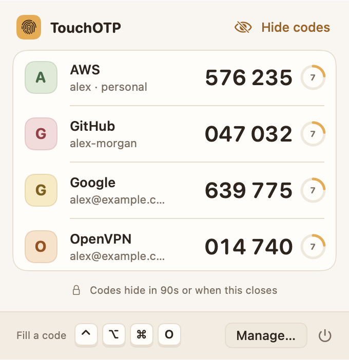
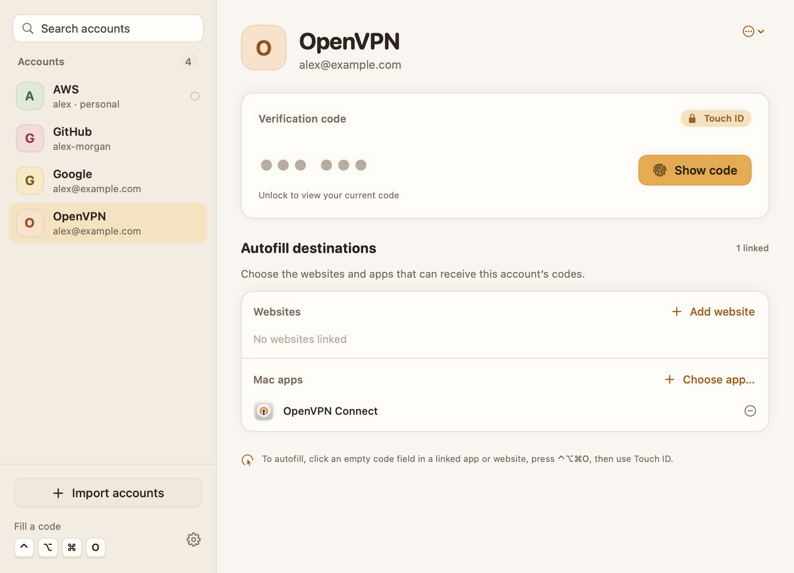

# TouchOTP

A local macOS menu-bar authenticator. Focus an empty verification-code field, press **Control + Option + Command + O** (`⌃⌥⌘O`), and authenticate with Touch ID. TouchOTP matches an account to the current website or native app and types its current TOTP code. Click the fingerprint icon in the menu bar to list every account and show all current codes with one Touch ID.

Version **0.2.0** introduces a native Mac interface: searchable accounts, a protected code panel with an expiry countdown, named app destinations, and a scan → review → setup import flow. Destination changes stay in a draft until you save with Touch ID; switching accounts offers to keep or discard unsaved changes. The interface follows the Mac's light/dark appearance and accent color, and includes a dedicated Autofill setup sheet and app icon.

Version **0.3.0** adds a menu bar code list. Clicking the fingerprint icon opens a popover with every account; **Show codes with Touch ID** reveals all current codes with their countdowns after a single authentication. Codes hide when the popover closes or after 90 seconds. Right-clicking the icon shows the classic menu with **Fill current field**. To make one-touch unlocking possible, all seeds now live in a single protected record instead of one record per account. Accounts saved by earlier versions are moved into the new vault from the Manage accounts window with a single Touch ID: one authenticated context is reused to unwrap each old record through its Secure Enclave key. If macOS refuses that shared authentication, TouchOTP falls back to one prompt per account, shows progress, and saves whatever was moved whenever you stop. Nothing is deleted until it has been moved. Adding accounts to an existing vault, editing destinations and removing an account each decrypt the vault and therefore ask for Touch ID. **Remove all accounts…** in Autofill setup is the recovery path after your enrolled fingerprints change.

The 0.3.0 interface also gets a warmer look with its own palette in place of the system accent color: linen and walnut tones (warm charcoal in dark mode), a honey accent, rounded numerals for codes, and a tinted initial tag for each account.

While **Show codes with Touch ID** waits, the popover says to touch the fingerprint sensor, and macOS shows its standard Touch ID dialog. Earlier 0.3.0 builds could show that prompt as a blank panel inside the popover, or hide it behind the manager window.





[Dark appearance at the compact window size](docs/ui/account-dark.png). These previews use sample accounts, never real account data.

This is a **development prototype**, built on this Mac on October 6, 2026. It is not a notarized distribution release. Automated tests and protected-storage diagnostics pass. The user confirmed successful OpenVPN Connect autofill with Touch ID using version 0.1.4 on October 6, 2026; browser autofill and other apps still need manual verification.

Version 0.1.1 fixes an import compatibility bug: Google migration exports with omitted or unspecified algorithm, digit-count or OTP-type settings now use the standard SHA-1, six-digit TOTP defaults. Explicit unsupported algorithms and HOTP are still rejected. Scan errors now distinguish a decoded QR whose account data was rejected from a camera that has not detected a QR.

Version 0.1.2 fixes the reported “unsupported version (2)” error by accepting version 2 migration envelopes. Existing account and batch validation still applies. Regression tests cover synthetic version 2 single-QR and multi-QR exports, additive metadata, and invalid account settings. After a real import, compare one generated code with Google Authenticator to verify your accounts.

Version 0.1.3 adds Electron Accessibility activation and a short asynchronous wait for the focused field, addressing the reported OpenVPN Connect field-discovery error. It also supports OpenVPN's masked challenge field when a small enclosing MFA dialog explicitly asks for an authenticator/verification code and contains only that text input. The field must still be verifiably empty. Focus changes cancel the request. Automated tests use synthetic Accessibility trees; an actual OpenVPN login with Touch ID remains a manual check.

Version 0.1.4 avoids repeating Electron Accessibility activation when it is already enabled or when checking the target after Touch ID. A local `last-fill-diagnostic.json` records only the latest attempt's stage, outcome, and boolean focus comparisons. It contains no codes, secrets, account names, URLs, UI text, or textbox contents; it stays in the TouchOTP Application Support directory and is overwritten on each completed attempt.

The reported post-Touch-ID “app, page or focused field changed” failure stopped after this change. The successful OpenVPN attempt recorded matching app, URL, window, and field, and the user confirmed the code filled. All 40 automated tests pass in this version.

## First use

1. Open `~/Applications/TouchOTP.app` (or `build/TouchOTP.app`). The fingerprint icon stays in the menu bar when you close the window. Click it to see your codes; right-click it for the menu.
2. Open **Autofill setup** using the gear at the bottom of the sidebar (or **⌘,**) and click **Test Touch ID**. This saves, unlocks and removes a disposable test secret. No account import is needed for this test.
3. Enable TouchOTP under **System Settings → Privacy & Security → Accessibility** when requested. This permission allows reading the focused field and inserting text. Each supported browser also asks for **Automation** permission to read its active tab URL.
4. Click **Import accounts**. On your phone, open Google Authenticator → Transfer accounts → Export accounts. Select accounts and scan every export QR using the Mac camera. Camera access is requested only when scanning. You can also choose a local QR image or enter an `otpauth://` setup link. Never send export QR codes or setup keys in chat.
5. Review the scanned accounts, click **Import**, then **Set up autofill**. Select an account and click **Add website** or **Choose app…**. Website entries must identify the **exact login hostname**, such as `accounts.google.com` or `github.com`; a pasted HTTPS login URL is reduced to its hostname. Click **Save changes** and confirm with Touch ID. Mac app rows show the installed app's name and icon.
6. Return to the login, focus an **empty ordinary OTP field**, and press **⌃⌥⌘O**. Check the account and destination named in the Touch ID prompt. TouchOTP inserts the code after successful authentication. It does not press Return or click Submit; a website may submit automatically when its field becomes complete.
7. To read a code instead of filling it, click the menu bar icon and choose **Show codes with Touch ID**. Every account's code and countdown appears until you close the popover, click **Hide codes**, or 90 seconds pass.

Google Authenticator remains usable. TouchOTP generates codes from the imported secret independently; it does not read your phone remotely or connect to Google Authenticator cloud sync. New or rotated secrets must be imported again. Keep your phone and account recovery codes.

If multiple imported accounts share a destination, a small account chooser appears before Touch ID. If no account matches, the error identifies the exact destination to add. Account names never automatically authorize a hostname.

## Coverage and limits

| Destination | Integration implemented |
| --- | --- |
| Safari and Safari Technology Preview | Active tab URL through Apple Events; focused web area checked through Accessibility |
| Chrome, Edge, Brave, Arc, Vivaldi, Opera | Chromium active-tab scripting API; focused web area checked through Accessibility |
| Firefox and other browsers | Only when Accessibility exposes both the active document URL and focused web-area URL; otherwise filling is refused |
| Native Mac apps | Explicit bundle-ID mapping and an exposed, empty Accessibility text field |

These integrations have **not yet been manually verified across all named apps**. Browser versions and custom controls vary. Embedded login frames, secure password-style OTP fields, some split-digit widgets and apps that ignore Unicode keyboard events may require manual entry using **Show code with Touch ID**. The app refuses unverifiable browser destinations rather than treating the whole browser as a trusted native app.

For **OpenVPN Connect**, select the imported VPN account, choose OpenVPN Connect as its Mac app destination, and save with Touch ID. Focus its empty **Authenticator Code** box and press **⌃⌥⌘O**. Masked-field recognition currently requires the English “Multi-factor authentication” heading and an authenticator/verification/one-time-code prompt in that field's enclosing dialog. Other languages, hidden field contents with no character count, or unrecognized dialogs require **Show code with Touch ID**.

The shortcut intentionally starts each request. TouchOTP does not continuously watch your screen or start biometric prompts whenever a webpage focuses an input. It reads the target on demand and matches it automatically against your saved destinations.

Only time-based codes (TOTP), SHA-1/SHA-256/SHA-512, and 6/8 digits are supported. Counter-based HOTP, SMS/email codes, push approvals, OAuth access tokens, passkeys and proprietary authenticators are outside this build. Google migration imports use the format's standard 30-second period; ordinary `otpauth` links also support custom periods. Existing issuer/username pairs are skipped during import, so remove a stale entry before importing a replacement secret.

## Storage and behavior

- All secrets and a protected copy of their destination mappings are stored together in one `LARightStore` record with `.biometryCurrentSet`. Keychain storage and its Secure Enclave key enforce biometric authorization. One authorization decrypts the whole vault, which is what lets the code list show everything after a single Touch ID; the trade-off is that every fill, edit or removal also decrypts every seed into this process's memory for the duration of that operation. The right is deauthorized after each read, and every change saves a new record before removing the previous one.
- The code list keeps the decrypted vault in memory only while the popover is open, for at most 90 seconds, and discards it when the popover closes or TouchOTP stops being the active app. Autofill never reuses it; the shortcut always authenticates on its own with a prompt naming the account and destination.
- Account names, usernames, record IDs, allowed destinations and the identifier of the protected record are stored in `~/Library/Application Support/TouchOTP/accounts.json`. This metadata contains **no OTP seed**. After authentication, it must match the protected copy before a code can be generated, shown or filled.
- No network client, analytics, screenshot collection, clipboard automation or remote server is included. Camera frames and decoded import material are processed in memory. A QR image you choose remains wherever you originally saved it; the app does not delete user files.
- Codes are generated after successful authentication. Near expiry, the app waits briefly for a fresh code. It rechecks the app, window, complete URL and focused empty field before sending a text event to the target process. There is no atomic cross-process “check URL and insert” API, so a small race remains; this is one reason to validate the prototype on your actual apps.
- Website matches are exact HTTPS hostnames on the default HTTPS port. Subdomains, lookalike domains and alternate ports are not automatically trusted. Native mappings identify an app by bundle identifier; they are not an attestation of that app's publisher.
- Adding or removing fingerprints invalidates the vault protected with the old biometric set. Open Autofill setup (**⌘,**), choose **Remove all accounts…**, confirm with Touch ID, and import again from your phone. There is no password fallback or secret-export function in this build.
- The raw seed necessarily exists briefly in this process's memory during import/code generation. Swift does not guarantee that every copy is immediately zeroed; the app does not claim otherwise.

## Build, renew and install

Requirements: macOS 13+, a Mac with Touch ID, Xcode, XcodeGen, and a development account signed in to Xcode. There are no third-party Swift packages.

```sh
git clone https://github.com/pratikaman/TouchOTP.git && cd TouchOTP
swift test
./scripts/build.sh
./scripts/install.sh
```

**The current personal-team provisioning profile expires October 13, 2026.** Rebuild and reinstall before/after expiry to renew it. The build uses this Mac's personal development team, not an organization team, and Xcode manages its app identifier and development profile. On a different team, set `TOUCHOTP_DEVELOPMENT_TEAM` before building. Keep the same bundle ID and signing team when upgrading to retain protected-storage access. A durable distributed version needs appropriate Apple distribution signing/provisioning and notarization; this prototype does not configure them.

`TouchOTP.xcodeproj` is generated from `project.yml` and can also be opened in Xcode. The script's `-allowProvisioningUpdates` permits Xcode to renew development provisioning with the account already signed in. Plain `swift build` compiles the code but does **not** produce a provisioned app capable of storing secrets.

To test protected storage without using a fingerprint or any real account:

```sh
build/TouchOTP.app/Contents/MacOS/TouchOTP --storage-check
```

This creates a synthetic protected secret, verifies that an unauthorized read fails, and removes the fixture. `--keychain-probe` lists the attributes and envelope size of the protected items this app can see, never their contents. `--render-preview /absolute/path/preview.png` renders the app with read-only sample accounts, without loading real account metadata or secrets. Preview switches include `--preview-empty`, `--preview-dark`, `--preview-compact`, `--preview-import`, `--preview-review`, `--preview-complete`, `--preview-setup`, and `--preview-codes` (the menu bar popover with synthetic seeds; add `--preview-locked` for the locked state). It does not capture the desktop. The original vector app icon is reproducible with `swift scripts/generate-icon.swift build/TouchOTP.iconset` followed by `iconutil -c icns build/TouchOTP.iconset -o Resources/TouchOTP.icns`.

## Validation

Automated tests cover all 18 RFC 6238 SHA-1/SHA-256/SHA-512 reference vectors, RFC 4226 six-digit values, Base32 decoding, standard and Google migration imports, multi-QR ordering/deduplication, malformed/fuzzed payloads, control-character rejection, exact-host/phishing cases, bundle IDs, and protected metadata round trips. See `Tests/TouchOTPCoreTests`.

`Tests/TouchOTPTests` covers delayed Electron field availability, focused-window fallback, cancellation when focus changes, rejection of another process's field/window, bounded retries, and recognition of OpenVPN's masked code dialog without reading other input values. It also checks rejection of password prompts, ambiguous dialogs, and nonempty or unverifiably empty masked fields.

Version 0.2.0 passes 45 automated tests, including website-address normalization, invalid/duplicate destination rejection, draft isolation, and preview storage isolation. Account, onboarding, import, review, completion, and setup views were inspected using synthetic renders in light/dark mode and at the compact window size. Live camera and Touch ID interactions still require manual interaction.

Version 0.3.0 passes 56 automated tests. The additions cover protected-vault round trips with tamper detection, decoding of pre-0.3.0 protected records, index-format detection (legacy, current, empty, missing and unreadable) with every change refused until migration completes, and the code-list model (unlock, matching by account identity, lock, and preview isolation). The migration itself, the per-operation Touch ID prompts and **Remove all accounts…** touch protected storage and remain manual checks.

Manual acceptance checks still required:

1. **Test Touch ID…** succeeds; cancelling a prompt produces no code.
2. Import one account locally and compare **Show code** with the phone.
3. Link its exact login hostname and successfully fill one real browser OTP field.
4. Switch tabs, fields or apps during the biometric prompt: filling must stop.
5. Link and test a native app, and test multiple-account selection where relevant.
6. Verify a near-expiry code, a rejected destination, and camera scanning with all pages of a multi-QR export.
7. Upgrading from 0.2.x: move the existing accounts with Touch ID, compare each code in the menu bar list with the phone, and confirm that closing the popover hides the codes.

## References

- [Apple: LARightStore](https://developer.apple.com/documentation/localauthentication/larightstore)
- [Apple: biometric requirements](https://developer.apple.com/documentation/localauthentication/laauthenticationrequirement)
- [Apple: keychain implementations and provisioning](https://developer.apple.com/documentation/technotes/tn3137-on-mac-keychains)
- [Google: transfer Authenticator accounts](https://support.google.com/accounts/answer/1066447)
- [RFC 6238](https://www.rfc-editor.org/rfc/rfc6238)
- [Electron: third-party Accessibility activation](https://github.com/electron/electron/blob/main/docs/tutorial/accessibility.md)

Apple's existing [Passwords verification-code autofill](https://support.apple.com/guide/passwords/automatically-fill-verification-codes-mchl873a6e72/mac) is also an option if you prefer a maintained system solution and its app/browser coverage fits your needs.
